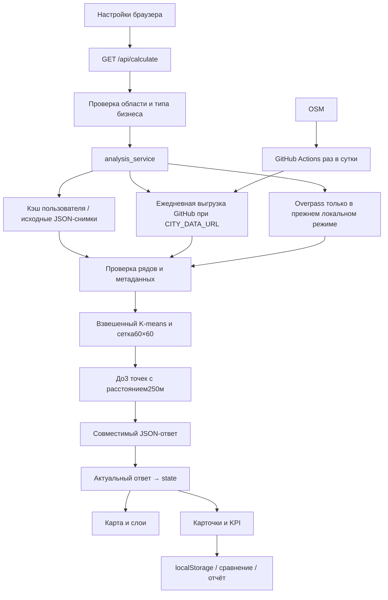
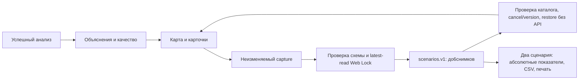

# Путь данных

Сохранённая пригодная копия читается сразу; данные старше7дней сопровождаются
предупреждением. Refresh пытается получить новую копию; сетевой отказ или
слишком малая новая выборка не заменяют пригодную старую. Запись через
временный файл и replace, блокировки не допускают одновременного обновления
одного ключа. Лимит2 расчётов защищает сервер; при перегрузке —503 и Retry-After30.

В режиме daily кнопка проверяет версию общей городской выгрузки. Повторный
файл/304 не меняет дату источника; повреждение, откат и переполнение населения
не заменяют рабочую копию. После фильтрации применяются прежние правила модели.
При отказе GitHub используются городская копия либо готовые районные снимки,
без сетевого Overpass с Render. `data_delivery` сообщает updated/unchanged/unavailable.

## Ограничения источников и карты

OSM — добровольная разметка, отсутствующий тег не доказывает отсутствие бизнеса.
Население оценивается по площади, этажам и типу здания; это не перепись.
Overpass может быть перегружен, недоступен и возвращать неполные данные.
Leaflet — отображение, а внешние тайлы OSM требуют сети даже при локальных снимках.
Повтор загрузки тайлов не повторяет математический расчёт.

На бесплатном Render кэш в /tmp теряется при новом развёртывании, исходные
снимки в Git остаются. Городская выгрузка восстанавливается с GitHub; после её
загрузки новые произвольные области фильтруются локально на сервере.
Модель использует прямые расстояния, не учитывает маршруты, аренду, помещения,
поток посетителей и доходы. Относительные score разных расчётов несопоставимы.

## Исследования и объяснимость

После scoring сервис формирует explanation для каждой точки и data_quality
из тех же исходных данных и metadata. Пояснения не вмешиваются в выбор/score.
calculated_at и запрошенный радиус области сохраняются отдельно от дат источника,
радиуса категории и возможного demo half_m600. Качество архива стареет при показе:
дата его сохранения не освежает OSM. Конкуренты в stats включают внешний запас.

Сохранённые отдельные места и прежний CSV продолжают свой поток. Новые записи
могут иметь дополнительные quality metadata; старые остаются валидны.
Никакие заметки/сценарии не отправляются на сервер или другой внешний сервис.

Каталог10×10 по-прежнему приходит с `/api/catalog`. До публикации отдельный
`scripts/import_osm_area.py` проверяет полный локальный OSM XML и готовит снимки
со временем/покрытием/хешем. В runtime загрузка идёт через прежний cache_service;
сборка Render не обращается к OSM за геоданными. Происхождение записано в
`data/catalog-provenance.json`. Старые18снимков и численные fixtures не меняются.
