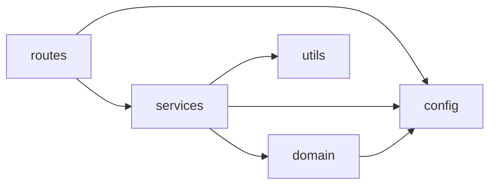

# Архитектура ГеоМаркетинга

Итерация от 12 октября 2026 года. Стек: Flask, Python, обычные HTML/CSS/JS,
Leaflet, JSON-снимки. Требования и визуальное направление согласованы в задании
пользователя; новая библиотека интерфейса, база данных и изменение модели не нужны.

## Отправная точка и целевая структура

До переноса `app.py` совмещал HTTP, проверку запросов, загрузку и вычисления;
`osm.py` — геометрию, Overpass и кэш; `workspace.js` — весь клиент.
Базовая проверка: 37 серверных тестов. После переноса проходит 51 тест.

| Каталог / файл | Ответственность |
| --- | --- |
| `app.py`, `serve.py` | Создание Flask-приложения, подключение маршрутов; запуск Waitress |
| `src/config.py` | Пути от корня репозитория, окружение, ограничения модели и сервера |
| `src/routes/` | HTTP-коды, аргументы запросов, JSON-ответы, защита от перегрузки |
| `src/domain/` | Категории, типы данных и численная модель; без Flask и сети |
| `src/services/` | Сценарий анализа, каталог, получение геоданных и кэш |
| `src/utils/` | Геометрия, проверка параметров и преобразование для JSON |
| `static/css/`, `static/js/` | Дизайн-система и клиентские модули |
| `static/assets/`, `static/vendor/` | Фирменные иконки, локальные шрифты и лицензированные сборки библиотек |
| `data/snapshots/` | Версионируемые исходные геоданные, доступные без Overpass |
| `data/fixtures/`, `tests/fixtures/` | Малые примеры формата и фиксированные тестовые входы |
| `tests/unit/`, `tests/integration/`, `tests/browser/` | Проверки модели/кэша, HTTP/импорта и сценариев браузера |
| `scripts/` | Диагностика, импорт снимков, проверка проекта |
| `docs/architecture/`, `docs/design/`, `docs/specs/`, `docs/plans/` | Устройство, визуальные правила, контракты и планы |

## Направление зависимостей

Домен и утилиты не импортируют HTTP-слой или точку входа `app.py`.
Сервисы не создают Flask-приложение. `config` не импортирует сервисы.
Клиентские модули направлены к `state.js` и `ui.js`; взаимные события
карты и карточек соединяются в `app.js`, чтобы не образовывать циклы.

## Границы совместимости

Не меняются `/`, `/healthz`, `/api/catalog`, `/api/calculate`, их JSON-форматы,
ошибки 400/500/503, `Retry-After`, пять категорий, параметры модели, сетка 60×60,
K-means, разделение рекомендаций 250 м. `best` остаётся первой рекомендацией.
Ключ `geomarketing.saved.v1`, структура записей, Web Locks и события хранилище
сохраняются. DOM-id, data-testid и aria-связи сохраняются при редизайне.

Корневые `osm.py` и `businesses.py` оставлены короткими совместимыми
входами: их ожидают старые инструменты и указанная команда py_compile.
Бизнес-логика при этом находится в `src/`, а не в этих файлах.

Перечень переносов и новых файлов: [change-map.md](change-map.md).
Пустой `static/assets/images/` не создавался: растровых изображений в интерфейсе нет.

## Как проверять

`python -m unittest discover -s tests -v`, `python scripts/validate_project.py`,
браузерные сценарии `tests/browser/smoke.js` и `tests/browser/workspace.js`.
Изменение API, модели, семафора, кэша, сохранений или отмены запросов требует
обновления соответствующих тестов. Итоговые результаты фиксируются в CHANGELOG.
