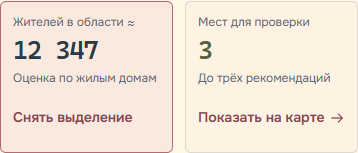
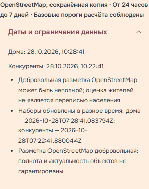

# Мобильные действия и аудит — 29 октября 2026

Сохранены палитра, шрифты, формула расчёта, API, карта и форматы хранения.
[План](../plans/2026-10-29-mobile-data-audit.md) и
[проверка достоверности](2026-10-29-data-reliability.md).

## Исправления интерфейса

KPI остаётся одной кнопкой на всю плашку. Подпись действия — 14 px при обычном
масштабе, строка не меньше 44 px, снизу 12 px. Подчёркивание, точка, нижняя полоса
и дополнительная тень убраны. Выбор обозначают спокойные фон и рамка, текст
«Снять выделение» и aria-pressed; подпись видна также на компьютере.
Стрелка взята из общего CSS-компонента, после снятия выбора возвращается.
На 320/360 px и при большом тексте сетка перестраивается в одну колонку.

Нижняя строка участвует в раскладке, поэтому увеличенный текст не накладывается
на пояснение. Полная область кнопки не обрезается нижней строкой и не меняется
из-за transform при нажатии. Реальными касаниями проверены углы, число и подпись.
Отступ стрелки и тонкая левая рамка выровнены: при 390 px действие помещается
в одну строку. Текст не уменьшался ради этой компоновки.

Система действий ограничена четырьмя ролями: залитое основное, вторичное с рамкой,
текстовое action-tertiary без подчёркивания и настоящая ссылка в тексте. Удаление
сохранённого места, показ места на карте, повтор загрузки и переход к деталям
используют третичное оформление, фокус и спокойный фон при наведении мышью.

«Даты и ограничения данных» получили внутренние отступы и отдельный резерв
шеврона, без сплошной подложки. Между заголовком и содержимым оставлен воздух.
Высота и прозрачность анимируются прежним initDisclosure; Enter/Space,
быстрые повторные нажатия и уменьшение движения сохраняют корректное состояние.
Системная подсветка касания summary не добавляет случайный цвет.

При тексте 200% обнаружены также переполнение заголовка карты и слишком широкая
минимальная ширина обновления данных. Они ограничены доступной шириной, диалоги —
высотой видимой области через dvh. Логика карты, обновления и диалогов не менялась.

## Данные и формулировки

Вместо «Данных достаточно для модели» используется «Базовые пороги расчёта соблюдены».
Статус проверяет количество домов, оценку жителей, наличие отмеченных конкурентов
и отсутствие предупреждений. Он не доказывает полноту OSM, свежесть или реальную
конкуренцию; даты и ограничения показаны отдельно.

Аудит отличает ежедневную рабочую выгрузку от 110 старых резервных снимков.
Подтверждены четыре реальных ответа API на свежей выгрузке от 29 октября и четыре
публичных объекта OSM. На тех же входах локально повторены все четыре сетки
по 3600 значений. Найдены семь избыточных повторов строк домов вне готовых районов
и риск двойного учёта узла/контура магазина. Они описаны как ограничения;
дедупликация и формула не менялись без подтверждения идентичности объектов.
Подробные числа, URL, методика, даты и пределы доказательств — в отдельном аудите.

В новом скрипте аудита независимое ревью нашло затенение флага runtime локальным
списком. Два теста сначала воспроизвели ошибку, затем подтвердили: автономный режим
не вызывает сеть при непустом кэше, а --runtime работает при пустом кэше.
Тесты создают свой отсутствующий каталог, поэтому не зависят от локальных артефактов.

## Очистка внутренних следов

Проверены собственные отслеживаемые код и документы; исключены Git-метаданные,
vendor, сторонние минифицированные файлы, лицензии и lock-файлы. Ненужных
упоминаний авторства инструментов и незавершённых служебных черновиков не найдено.
Содержательная документация не удалялась.

Сохранены технические совпадения:

- `.codex` в `.dockerignore` и объяснение в плане истории — исключение локальной
  папки из Docker-контекста, не содержимое приложения.
- HTTP `User-Agent` в `src/config.py`, `scripts/diagnose_osm_network.py`,
  `src/domain/city_data.py` и новом `scripts/audit_data.py` — стандартный заголовок
  публичных запросов; его пояснение в плане истории также необходимо.
- recommendation-placeholder, draft пользовательского исследования, временные
  файлы атомарной записи и снимки анимации — действующие технические понятия.

План сопровождения истории обновлён: новые коммиты короткие, строчными буквами
на русском, без префиксов и отдельной служебной фиксации результатов. Опубликованная
история сохраняется; её переписывание требует отдельного согласия владельца.

## Проверки и ограничения

117 Python-тестов и 89 Node-тестов прошли. Проверены структура проекта,
импорты, DOM ID, палитра и синтаксис изменённых JS-модулей.
Новый mobile-actions проверяет 320/360/390/430/768/1280 px с текстом 100/200%,
геометрию, настоящие касания, клавиатуру, фокус и уменьшение движения.
Регрессии: visual-polish, visual-polish-layout, mobile-motion-polish,
workspace-interactions, scenarios-ui, mobile-analysis-accessibility.
В прогонах нет ошибок JavaScript. После окончательных исправлений касаний
повторно проверены затронутые визуальная матрица и рабочие взаимодействия.

Один промежуточный запуск не достиг страницы: после перезапуска среды локальный
сервер был остановлен. Ошибки соединения не считались проверкой приложения;
сервер поднят заново, проверки повторены.

Эмуляция Chromium не заменяет реальные устройства, Safari/Firefox и screen reader.
Административная принадлежность по полигону, полнота OSM, полевая актуальность,
заселённость домов и коммерческий успех не подтверждены. Относительный балл
сравним внутри одного расчёта, а не как прогноз доходности между районами.
Этот документ фиксирует проверку исходников; факт публикации проверяется отдельно
по коммиту и реальным ответам сервиса, без отдельного служебного коммита.

## Изменённые файлы

- `static/css/base.css`, `components.css`, `map.css`, `responsive.css`, `scenarios.css`,
  `states.css`, `tokens.css`: действия, отступы, фокус, переносы; добавлен только
  размер текста действия, цветовые токены и шрифты сохранены.
- `static/js/kpi-interactions.js`: подпись/иконка, область касания и спокойный отклик.
- `static/js/data-quality.js`: точная подпись статуса.
- `static/js/recommendations.js`, `saved-places.js`: класс третичного действия.
- `scripts/audit_data.py`, `tests/unit/test_model_invariants.py`, `test_audit_data.py`,
  `tests/browser/mobile-actions.js`: воспроизводимый аудит и проверки.
- README, CHANGELOG, дизайн-система, план истории, план этапа, два отчёта,
  снимки ниже, state и журнал решений: документация, связанная с изменением.

## Мобильные снимки

390×844, обычный размер текста, уменьшение движения для стабильного кадра.
Данные локального снимка не подменяют даты рабочей выгрузки из отдельного аудита.

