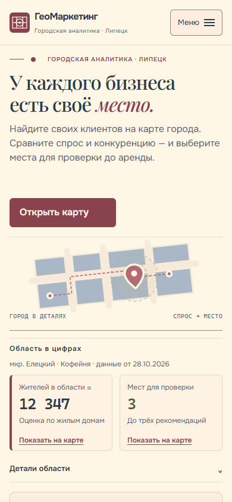
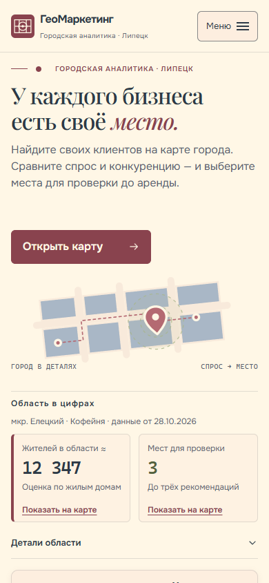
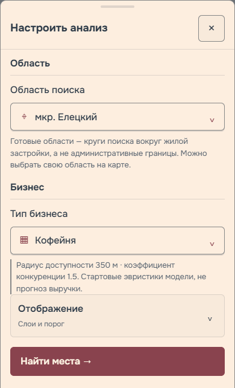
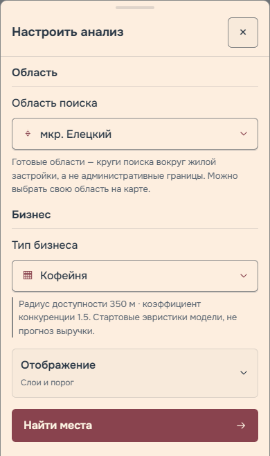
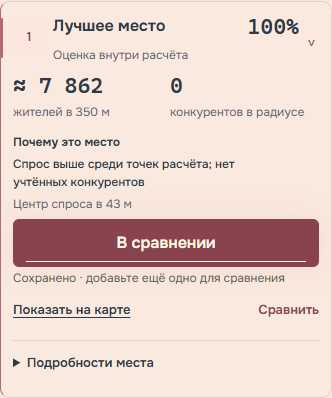
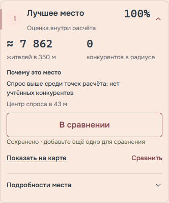

# Визуальная полировка — 29 октября 2026

[Спецификация](../specs/2026-10-29-visual-polish.md) ·
[План](../plans/2026-10-29-visual-polish.md).

## Что было несогласованно

Использовались текстовые `⌄`/`⌃`, нативные треугольники summary, разные размеры
и скорости стрелок. Внутренние диалоги/печать обозначались внешним `↗`.
Перед схемой была декоративная линия; под hero — две близкие горизонтальные
границы. Сохранение одновременно выделялось подписью, рамкой и нижней полоской;
рекомендация — рамкой и ведущей линией. Сравнение выглядело отдельной карточкой.
Часть hover-правил действовала на сенсорных устройствах, press масштабировал поля.

Дополнительно обнаружены нулевой отступ перед «Отображением», разрыв бренда внутри
слова при 320px/200%, старый сброс поворота при reduced motion и конфликт padding
вложенных summary. Все исправлены без смены функций и шрифтов.

## Линии и иерархия

| Изменение | Основание |
| --- | --- |
| Убрана верхняя линия мобильной схемы | CTA и схема — одна композиция |
| Убрана нижняя линия hero | Граница с цифрами уже есть у analysis-context-row |
| Убрана дублирующая акцентная граница рекомендации | Сохранилась одна ведущая вертикальная Rosewood-линия |
| Убрана нижняя полоска сохранения | Состояние уже обозначено текстом и оформлением кнопки |
| Панель сравнения без рамки/заливки, отступы меньше | Это переход к следующему действию |
| Убрана повторная линия brief внутри подробностей | Достаточно разделения самого раскрытия |
| Убраны лишние границы заголовка сохранений/пустых блоков/чек-листа | Поля и отдельные карточки уже задают структуру |
| Убрана рамка раскрытия источников | Вспомогательная информация остаётся доступной и спокойной |
| Убрана тонкая граница над статусом карты | Переход светлого заголовка к тёмной строке уже разделяет их |

Рамки интерактивных полей/карточек, самостоятельных разделов и плотных строк
таблиц сохранены. Визуал и подписи схемы остаются. Палитра и типографика прежние.

## Система направлений

`static/css/directional-icons.css`: четыре локальные SVG-маски, единая геометрия,
размер 1rem и одинаковый штрих; цвет наследуется от элемента. Нет внешних запросов
иконок, CDN или новой зависимости.

| Роль | Где применяется |
| --- | --- |
| Chevron, разворот 180° | Все summary, выбор района/бизнеса/радиуса, мобильная рекомендация/настройки |
| Вперёд | Карта, запуск анализа, внутренние диалоги/следующее действие |
| Наружу | Ссылки карточек на OpenStreetMap с target=_blank |
| Скачивание | CSV и выгрузка исходного JSON |

Текстовые стрелки в подписях самой схемы сохранены по запросу: «Спрос → место».
Они объясняют схему и не служат иконками управления. Нативные маркеры всех details
убраны. Одинаковый motion-fast(220ms) отвечает за поворот; reduce отключает переход,
сохраняя итоговое направление. aria-expanded синхронизируется также у новых native
details; прежние контроллеры и Enter/Space не заменены.

Hover ограничен hover:hover/pointer:fine. Press не меняет размер. Сохраняются
focus-visible, подписи выбранного/сохранённого состояния и цели минимум 44px.
На 320px меню компактное с доступным именем; бренд переносится между Гео/Маркетинг.

## Изменённые файлы

- `static/index.html`: подключение компонента, направления, перенос бренда/имя меню.
- Новый `static/css/directional-icons.css`; CSS `components.css`, `field-checks.css`,
  `hero.css`, `layout.css`, `map.css`, `responsive.css`, `scenarios.css`, `states.css`.
  Все находятся в `static/css/`. В map.css только оформление строки/кнопок.
- `static/js/choices.js`: удалён текстовый chevron.
- `static/js/recommendations.js`: локальная внешняя иконка вместо глифа.
- `static/js/app.js`: подпись запуска без встроенного глифа; стрелка задаётся CSS.
- `static/js/ui.js`: синхронизация aria-expanded, включая динамические native details.
- `scripts/validate_project.py`: новый обязательный CSS-файл.
- `tests/browser/visual-polish.js`, `visual-polish-layout.js`: новые проверки.
- Шесть PNG в `docs/verification/assets/2026-10-29-visual-polish/`.
- Документация: README, CHANGELOG, design-system, frontend architecture, спецификация,
  план, этот отчёт, state и session-log.

Сервер/API/модель, map.js/Leaflet, логика сохранений/сравнения/архива,
CSV/печать, форматы хранения, зависимости/vendor не менялись.

## Проверка

- Структура 91 файлов,89 Node-тестов,106 Python-тестов, JS syntax/diff check.
- visual-polish:15 раскрытий; единые маски/размеры; native markers отсутствуют;
  Enter/Space, coarse hover, reduced motion, press, реальные внешние роли,
  быстрые повторы, программное открытие и смена reduced motion при закрытии.
- visual-polish-layout:320×568,390×844,430×932,768×1024,1280×900 ×100/200%.
  Длинные названия района и бизнеса; реальные сохранение/чек-лист, резерв для
  chevron, источник/клавиатура; нет горизонтального скролла или JS-ошибок.
- Связанные регрессии прошли: mobile-choice-touch, connected-workspace,
  connected-layout, connected-geometry-focus, workspace-interactions,
  field-checks, mobile-analysis-accessibility. Включены CSV/печать/архив,
  перенос формы, фокус, ошибки хранения и проверка 44px.
- В ранее существующем choice-menus.js обнаружен устаревший сценарий проверки:
  при 360px он ищет поле в закрытой мобильной панели и завершается таймаутом.
  Тест не менялся и не использован как основание приёмки. Актуальные выбор,
  клавиатура, сенсорная прокрутка и геометрия проверены указанными наборами.
- Независимое ревью: две ошибки CSS (reduce override и specificity padding)
  воспроизведены RED, исправлены и отдельно подтверждены GREEN. Остальных
  дефектов не найдено; reviewer независимо проверил матрицу и переходы.

## Скриншоты до и после

Сняты при 390×844, одинаковых настройках/данных/состояниях, уменьшение движения
включено для стабильного кадра. «После» переснято после всех исправлений ревью.

### Мобильный hero

| До | После |
| --- | --- |
|  |  |

### Панель настройки

| До | После |
| --- | --- |
|  |  |

### Сохранённая рекомендация

| До | После |
| --- | --- |
|  |  |

## Публикация и ограничения

Публичная проверка будет зафиксирована после выпуска. Chromium-эмуляция не
подтверждает физические телефоны, Safari/Firefox и реальный screen reader.
